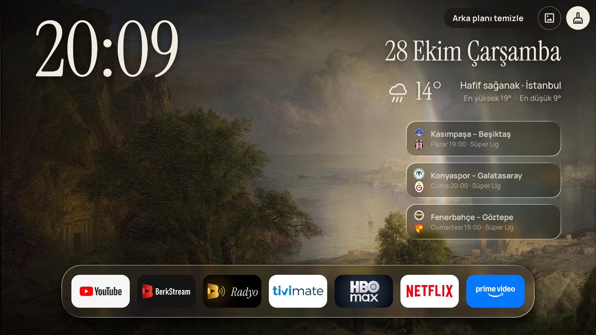

# BerkOS

Google TV için sakin bir ana ekran. Google TV'nin reklam ve öneri dolu ana ekranı yerine saat, hava, bugünün maçları, kaldığın yer ve boşta dönen tablolar.

**Sayfa:** https://berkdemir18.github.io/BerkOS/



## İndir

[Releases](https://github.com/berkdemir18/BerkOS/releases/latest) sayfasında:

- `BerkOS-Kurulum.zip`: BerkOS + Radyo + Windows kurulum scripti (önerilen)
- `BerkOS.apk`: sadece ana ekran
- `BerkOS-Radyo.apk`: sadece Radyo

## Kurulum (5 dakika)

**Bilgisayarın yok mu?** Sadece TV ve kumandayla: [kolay kurulum rehberi](https://berkdemir18.github.io/BerkOS/kolay-kurulum/). TV'deki Downloader uygulamasına `berkdemir18.github.io/BerkOS/tv` yazman yeterli.

Bilgisayarla:

1. **TV'de:** Ayarlar › Sistem › Hakkında › *Android TV OS derlemesi*'ne 7 kez bas. Sonra Geliştirici seçenekleri › *USB hata ayıklama*'yı aç. TV'nin IP adresini Ayarlar › Ağ'dan not et.
2. **Bilgisayarda** (TV ile aynı Wi-Fi'da): zip'i çıkar, `BerkOS'u TV'ye Kur.bat`'a çift tıkla, IP'yi yaz.
3. TV "USB hata ayıklamaya izin verilsin mi?" derse *Her zaman izin ver*.

Script adb'yi gerekirse Google'ın kendi sunucusundan indirir, BerkOS'u ve Radyo'yu yükler, ekran koruyucuyu ve Ev tuşu yardımcısını açar.

**Geri almak:** `BerkOS'u Kaldir.bat`. Google TV eski hâline döner.

## Neler var

- Büyük saat, tarih, seçtiğin şehrin havası (81 il, ilk açılışta yaklaşık konum)
- Süper Lig maçları: saat, kanal, canlı skor, maç detayı
- İzlemeye devam et, takip ettiğin YouTube kanallarından yeni videolar, Netflix Türkiye ilk 10
- Cam uygulama çubuğu, tüm uygulamalar, arka planı temizle
- Sergi: TV boşta kalınca kamu malı tablolar ve NASA uzay fotoğrafları

## Radyo

Ayrı bir uygulama (`com.demir.radyo`), kurulum paketiyle birlikte gelir. 557 Türk radyosu, eski usul kadranlı arayüz, arka planda çalar. Kategoriler, favoriler, kumandanın kanal/medya tuşları, uyku zamanlayıcısı. Yayın adresi değişen radyonun yenisini kendisi arar. BerkOS ana ekranındaki eski radyo bu uygulamayı çalar. Kadrandaki FM frekansları Ankara'nın. Kaynak: [`radyo/`](radyo).

## İzinler

**Erişilebilirlik (Ev tuşu yardımcısı):** Ev tuşuna basınca Google TV kendi ekranını açıyor; BerkOS bunu fark edip öne geçmek için kullanır. Google TV ekranındayken sadece "İzlemeye devam edin" başlıklarını okur. Başka uygulamaların ekranını okumaz, hiçbir yere bir şey göndermez.

Hesap yok, reklam yok, takip yok. Android TV 8 ve üstü.

## Kaynaktan derleme

JDK 17+ ve Android SDK gerekir (`local.properties` içinde `sdk.dir`).

```
gradlew assembleGenelRelease
```

APK `app/build/outputs/apk/genel/release/` altına çıkar. Radyo için aynısı `radyo/` klasöründe. İmza anahtarı depoda yok; yoksa debug imzasıyla derlenir.

Kod Kotlin, arayüz kütüphanesiz (View tabanlı). Giriş noktaları: `MainActivity` (ana ekran), `EvTusuServisi` (Ev tuşu yardımcısı, `Sergi.kt`), `SalonDream` (ekran koruyucu), `Oneriler` (satırlar). Sürüme özel parçalar `app/src/<çeşit>/java/.../Ek.kt` içinde.

## Lisanslar

- Fontlar: Instrument Serif ve Manrope, SIL Open Font License 1.1 (`app/src/main/assets/fonts/OFL-*.txt`)
- Tablolar ve uzay fotoğrafları kamu malıdır (Wikimedia Commons, Art Institute of Chicago, NASA); künyeleri `app/src/main/assets/koleksiyon.json` içinde.
- Hareketli sahneler Mixkit'ten akış olarak gelir (Mixkit Free License), uygulamaya gömülü değildir.
- Uygulama logoları sahiplerine aittir.

BerkOS'un kendi kodu için henüz bir lisans seçilmedi: tüm hakları saklıdır.
